# Requirements index — `apps/crm/requirements`

<!-- GENERATED by requirements/check.mjs — do not edit by hand. -->
<!-- Regenerate with `yarn requirements:build`. -->

| ID | Title | Status | Type | Priority | Source |
|---|---|---|---|---|---|
| [`REQ-CRM-BARE-001`](bare.md#req-crm-bare-001--every-page-works-as-raw-html) | Every page works as raw HTML | active | constraint | P1 | sean |
| [`REQ-CRM-BUTTON-001`](button.md#req-crm-button-001--a-button-that-cannot-act-is-off-with-its-reason) | A button that cannot act is off, with its reason | active | constraint | P2 | sean |
| [`REQ-CRM-DATE-001`](date.md#req-crm-date-001--one-format-for-each-date-and-time) | One format for each date and time | active | constraint | P1 | sean |
| [`REQ-CRM-FORM-001`](form.md#req-crm-form-001--the-create-page-and-the-edit-page-show-one-form) | The create page and the edit page show one form | active | constraint | P1 | sean |
| [`REQ-CRM-ID-001`](id.md#req-crm-id-001--no-uuid-in-a-url-or-on-a-page) | No UUID in a URL or on a page | active | constraint | P1 | sean |
| [`REQ-CRM-LAYOUT-001`](layout.md#req-crm-layout-001--one-breakpoint-and-a-4060-grid-of-the-device-and-the-boxes) | One breakpoint, and a 40/60 grid of the device and the boxes | superseded | constraint | P1 | sean |
| [`REQ-CRM-LAYOUT-002`](layout.md#req-crm-layout-002--one-breakpoint-and-the-rack-over-the-band) | One breakpoint, and the rack over the band | active | constraint | P1 | sean |
| [`REQ-CRM-LCD-001`](lcd.md#req-crm-lcd-001--no-led-in-the-glass-characters-that-do-not-move-and-leds-in-the-bezel) | No LED in the glass, characters that do not move, and LEDs in the bezel | superseded | constraint | P1 | sean |
| [`REQ-CRM-LCD-002`](lcd.md#req-crm-lcd-002--leds-on-metal-one-mark-in-the-glass-and-rows-that-do-not-move) | LEDs on metal, one mark in the glass, and rows that do not move | active | constraint | P1 | sean |
| [`REQ-CRM-MCP-001`](mcp.md#req-crm-mcp-001--no-mcp-tool-deletes-erases-or-touches-money) | No MCP tool deletes, erases or touches money | active | constraint | P1 | sean |
| [`REQ-CRM-MORPH-001`](morph.md#req-crm-morph-001--a-press-updates-the-page-in-place-with-focus-and-scroll-kept) | A press updates the page in place, with focus and scroll kept | active | functional | P2 | sean |
| [`REQ-CRM-UNDO-001`](undo.md#req-crm-undo-001--one-history-that-only-grows-and-no-delete) | One history that only grows, and no delete | active | constraint | P2 | sean |
| [`REQ-CRM-UNDO-002`](undo.md#req-crm-undo-002--undo-and-redo-are-one-stack) | Undo and Redo are one stack | active | functional | P2 | sean |
| [`REQ-CRM-UNDO-003`](undo.md#req-crm-undo-003--restore-shows-one-hidden-record-one-time) | Restore shows one hidden record, one time | active | functional | P2 | sean |

## Dependency graph

```mermaid
graph TD
  REQ_CRM_BARE_001["REQ-CRM-BARE-001<br/>Every page works as raw HTML"]
  REQ_CRM_BUTTON_001["REQ-CRM-BUTTON-001<br/>A button that cannot act is off, with its reason"]
  REQ_CRM_DATE_001["REQ-CRM-DATE-001<br/>One format for each date and time"]
  REQ_CRM_FORM_001["REQ-CRM-FORM-001<br/>The create page and the edit page show one form"]
  REQ_CRM_ID_001["REQ-CRM-ID-001<br/>No UUID in a URL or on a page"]
  REQ_CRM_LAYOUT_001["REQ-CRM-LAYOUT-001<br/>One breakpoint, and a 40/60 grid of the device and the boxes"]
  REQ_CRM_LAYOUT_002["REQ-CRM-LAYOUT-002<br/>One breakpoint, and the rack over the band"]
  REQ_CRM_LCD_001["REQ-CRM-LCD-001<br/>No LED in the glass, characters that do not move, and LEDs in the bezel"]
  REQ_CRM_LCD_002["REQ-CRM-LCD-002<br/>LEDs on metal, one mark in the glass, and rows that do not move"]
  REQ_CRM_MCP_001["REQ-CRM-MCP-001<br/>No MCP tool deletes, erases or touches money"]
  REQ_CRM_MORPH_001["REQ-CRM-MORPH-001<br/>A press updates the page in place, with focus and scroll kept"]
  REQ_CRM_UNDO_001["REQ-CRM-UNDO-001<br/>One history that only grows, and no delete"]
  REQ_CRM_UNDO_002["REQ-CRM-UNDO-002<br/>Undo and Redo are one stack"]
  REQ_CRM_UNDO_003["REQ-CRM-UNDO-003<br/>Restore shows one hidden record, one time"]
  REQ_CRM_LAYOUT_001 -->|superseded-by| REQ_CRM_LAYOUT_002
  REQ_CRM_LAYOUT_002 -->|supersedes| REQ_CRM_LAYOUT_001
  REQ_CRM_LCD_001 -->|superseded-by| REQ_CRM_LCD_002
  REQ_CRM_LCD_002 -->|supersedes| REQ_CRM_LCD_001
  REQ_CRM_MORPH_001 -->|depends-on| REQ_CRM_BARE_001
  REQ_CRM_UNDO_002 -->|depends-on| REQ_CRM_UNDO_001
  REQ_CRM_UNDO_003 -->|depends-on| REQ_CRM_UNDO_001
  style REQ_CRM_LAYOUT_001 stroke-dasharray: 4 4
  style REQ_CRM_LCD_001 stroke-dasharray: 4 4
```

## Derived reverse links

- `REQ-CRM-BARE-001` — required-by REQ-CRM-MORPH-001
- `REQ-CRM-UNDO-001` — required-by REQ-CRM-UNDO-002, required-by REQ-CRM-UNDO-003
