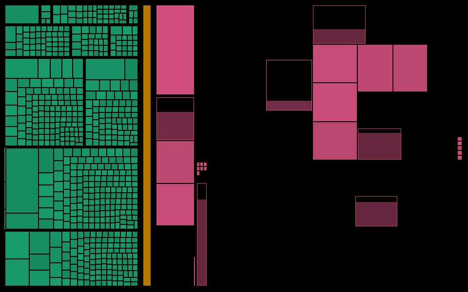

# bootmap

bootmap shows the boot of a Linux machine as a live treemap. The screen
starts black. Each box is one step of the boot: a kernel initcall, the
initramfs, or a systemd unit. A box fills when its step completes. When every
box is full, the login screen opens.



## How it works

Three programs draw one picture on the same framebuffer, one after the other:

| Stage | Program | It fills |
|---|---|---|
| 1 | Zig UEFI loader (`src/loader/`) | the firmware and loader boxes. Then it loads the UKI. |
| 2 | Kernel patch (`kernel/`) | one box for each initcall, live, from the `initcall_start` and `initcall_finish` tracepoints |
| 3 | Zig daemon in the initramfs (`src/daemon/`) | the systemd boxes, live, from the systemd job list |

The squarify layout exists in Zig (`src/layout/treemap.zig`) and in C
(`kernel/bootmap_layout.c`). It uses integer math only, so the two give the
same rectangles (REQ-BOOTMAP-001). All three programs draw with
`src/render/canvas.zig` into an XRGB8888 buffer. The GOP framebuffer and a
DRM dumb buffer have that format.

The size of a box is `floor(sqrt(duration in µs)) + 16`, from a recorded
boot. Stages and groups stay in boot order. The leaves in a group are sorted
by size.

## Options

The same options work as kernel command-line parameters
(`bootmap.fill=spiral`) and as CLI and replay arguments (`fill=spiral`).
`src/render/style.zig` and `kernel/bootmap.c` implement them.

| Option | Default | Values |
|---|---|---|
| `fill` | `raster` | `raster`: left to right, top to bottom, pixel by pixel. `rows-up`: whole lines from the bottom. `spiral`: pixel by pixel, from the edge to the centre. |
| `fill_ms` | `250` | The shortest fill of a box, in ms. A box that completes sooner still fills over this time, so you see it fill. |
| `outline` | `1` | The outline width, in the stage colour, when a box spawns. `0`: no outline. |
| `empty` | `black` | The colour of the part of a box that is not full: `black`, `white`, `dim` (the stage colour at 25 %) or `#rrggbb`. |
| `spawn` | `start` | `start`: a box appears when its step starts. `plan`: all boxes appear in the first frame. |
| `gap` | `1` | The space between two boxes, in pixels. |
| `pad` | `1,1,1` | The inset of the screen, a stage and a group, in pixels. |
| `warn_ms` | `500` | After this time in flight (or 2× its expected time, if known), a step is late. The pixels that it paints from then on are yellow. |
| `labels` | `all` | `all`: names in the boxes and titles above areas. `areas`: titles only. `none`. A group with one member has no title. |
| `font` | `6x8` | `6x8` or `4x6`: the kernel's bitmap fonts. |
| `overflow` | `wrap` | `wrap`: a name breaks after a non-word character (`xyz.` / `service`). A word longer than a line breaks inside the word. `cut`: one line. |
| `fit` | `whole` | When a box shows its name: `whole` (the whole name fits), `words` (the whole name fits, and no word is split), `word` (the first word is not split), `chars:N`, `percent:N`, or `any`. |
| `order` | `boot` | How groups and boxes are placed. `boot`: in boot order. `size`: largest first. `best`: `boot` or `size`, whichever gives the squarer worst box. The stages always keep boot order. |
| `other` | `10` | In thousandths of a stage. When two or more groups are smaller than this, their boxes go into one `other` group, the last one (bottom right). `0`: never. Every box is still drawn. |
| `ink` | `inverse` | The text pixels: `inverse` (black on filled pixels, the stage colour on empty pixels), `white` or `black`. |
| `late` | `clear` | `clear`: when a late step completes, its yellow pixels get the stage colour. `keep`: they stay yellow, as a record. |

One pixel is one unit (REQ-BOOTMAP-006). Nothing is drawn wider than 1 px
for emphasis. A state shows in the colour of single pixels.

A box fills to 90 % over its expected time. After that, it moves on towards
100 % more and more slowly, and gets there only when its step completes. So a
late step still paints pixels, and the yellow pixels show how late it is. The
kernel does not know an initcall's time, so its boxes use `fill_ms` as the
expected time. A box that fails is red, with a 1 px cross.

In the replay, F changes the fill, E the empty colour, O the outline, and S the
spawn mode.

## Status

| Part | State |
|---|---|
| Record a boot (`vm/record-trace.sh`) | done |
| Layout, model, renderer, CLI, replay window | done |
| Zig and C layout parity (`test/layout-parity.sh`) | done |
| Kernel patch: live initcall boxes, fill animation, options | done |
| Initramfs daemon and the handoff from the kernel | not started |
| UEFI loader | not started |
| Greeter handoff | not started |

## Use it

Zig 0.17 is necessary. The replay window also needs SDL2 and wgpu-native in
`~/.local/lib`, as for [swindowzig](https://github.com/seanmizen/swindowzig).

```bash
zig build test                    # unit tests
test/layout-parity.sh             # Zig and C layouts agree
zig build replay -- traces/debian13-cloud-tcg.json
zig build cli -- snapshot traces/debian13-cloud-tcg.json out.png --at 30
zig build cli -- stats traces/debian13-cloud-tcg.json
kernel/fetch-and-build.sh         # build the kernel with bootmap
vm/run.sh --kernel-only --show    # boot it in a QEMU window
```

In the replay window: Space pauses, R restarts, and Left and Right change
the speed.

## Record a boot

`vm/record-trace.sh` boots the Debian 13 cloud image in QEMU with OVMF and
writes a trace to `traces/`. The first boot adds `initcall_debug` to the
kernel command line and reboots. The second boot is the one that the trace
records. `vm/collect-trace.py` runs on the guest and prints the trace.

```bash
mkdir -p working && cd working
curl -fLO https://cloud.debian.org/images/cloud/trixie/latest/debian-13-genericcloud-amd64.qcow2
cd .. && vm/record-trace.sh
```

The script uses KVM if `/dev/kvm` is writable, and TCG if not. Under TCG, a
recording takes about 5 minutes and the boot takes about 70 s. The trace
name has the accelerator in it, because TCG makes every step slower.

## Folders

| Folder | Contents |
|---|---|
| `src/` | Zig: `layout/`, `model/`, `render/`, `cli/`, `replay/` |
| `kernel/` | C: the kernel patch (`bootmap.c`), its layout, the config, the build script |
| `test/` | the layout parity test |
| `vm/` | the boot recorder |
| `traces/` | recorded boots |
| `requirements/` | REQ-BOOTMAP-* |
| `working/` | downloads, VM disks, kernel builds. Gitignored. |
