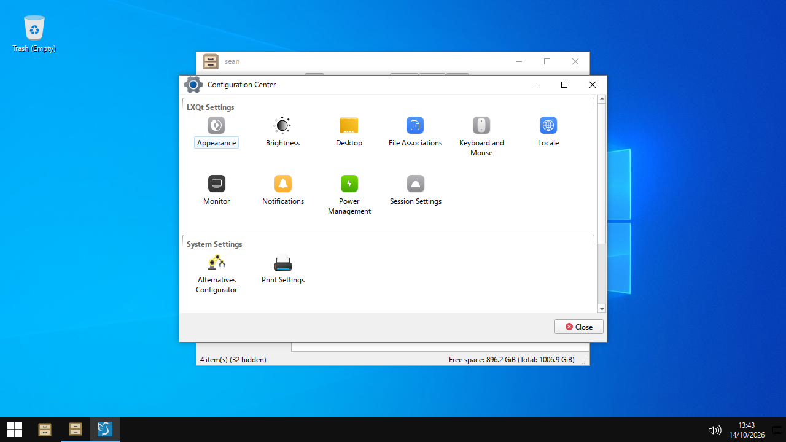

# winlike

> **Prototype.** winlike was a one-day experiment (2026-10-14). It is not
> installed on any machine, and nobody maintains it. The scripts and the
> config files stay here as a record. See
> [Potential improvements](#potential-improvements) for the work that stopped.

A Linux desktop with the behavior and layout of Windows 10. It runs in a window
on the Windows desktop through WSLg, so you can change it and test it quickly.

It uses no Microsoft files and no copies of them. The icons, cursors, font,
wallpaper and start button logo are Debian defaults. Each menu label gives the
name of the app that it opens.



| Part | Tool |
|---|---|
| Window manager (compositor) | [labwc](https://labwc.github.io/) 0.8 with the `winlike` theme from this directory |
| Taskbar and start menu | `lxqt-panel` 2.1 with the `winlike` LXQt theme from this directory |
| Desktop (wallpaper, icons, rubber-band select) | `pcmanfm-qt --desktop` |
| Terminal | [Ghostty](https://ghostty.org/) 1.3.1. It runs your login shell (zsh). See [Terminal](#terminal). |
| Icons | breeze (`breeze-icon-theme`). The taskbar volume glyph comes from breeze-dark. |
| Cursors | Breeze_Light (`breeze-cursor-theme`) |
| GTK theme | Adwaita, the GTK default |
| Font | Open Sans (`fonts-open-sans`). Monospace stays the Debian default, DejaVu Sans Mono. |
| Wallpaper | The Debian default (`desktop-base`) |
| Start button | The Debian logo (`desktop-base`) |

Tested on Debian 13 (trixie) in WSL2 on Windows 10, with WSLg.

## Use it

```bash
utils/winlike/install.sh     # install or update. Safe to run again.
winlike                      # start the desktop in a window
winlike --fullscreen         # start it at the size of the Windows monitor
winlike-keytest              # find which keys get through to labwc
utils/winlike/uninstall.sh   # remove it all
```

`winlike` asks for `sudo` one time after each WSL start. WSLg mounts
`/tmp/.X11-unix` read-only, and Xwayland needs to write there.

## Keyboard

Windows probably keeps these keys for itself (run `winlike-keytest` to
check): every Win combination, Alt+Tab,
Alt+Space, Ctrl+Esc, Ctrl+Shift+Esc and PrtScn. They get to winlike only
when [`windows/winlike-capture.ahk`](windows/winlike-capture.ahk) captures
the keyboard. Right Ctrl releases it, as in VMware. Without capture, Alt+F4
can close the whole WSLg window. Windows always gets Win+L and Ctrl+Alt+Del.
See [docs/keyboard-capture.md](docs/keyboard-capture.md) for the setup and
the test results.

| Keys | Action |
|---|---|
| Win | Open the start menu |
| Ctrl+Esc | Open the start menu |
| Alt+F4 | Close the window |
| Alt+Tab, Alt+Shift+Tab | Switch windows |
| Win+Tab | Switch windows (there is no Task View) |
| Alt+Space | Window menu |
| Win+Left, Win+Right | Snap the window to half of the screen |
| Win+Up | Maximize |
| Win+Down | Restore a maximized or snapped window, else minimize |
| Win+Shift+Up | Stretch the window to full height |
| Win+D, Win+M | Show the desktop |
| Win+1 to Win+9 | Open the app at that taskbar position |
| Win+E | PCManFM-Qt file manager (`pcmanfm-qt`) |
| Win+R | LXQt Runner (`lxqt-runner`) |
| Win+I | LXQt Configuration Center (`lxqt-config`) |
| Win+X | Win+X menu (Windows calls it the Quick Link menu) |
| Ctrl+Shift+Esc | Qps process viewer (`qps`) |
| PrtScn | Copy the screen to the clipboard |
| Win+PrtScn | Save `~/Pictures/Screenshots/Screenshot (N).png` |
| Win+Shift+S | Select an area and copy it to the clipboard |
| Right Ctrl (alone) | Turn keyboard capture off or on (`winlike-capture.ahk`) |
| Ctrl+Alt+Enter | Full screen on or off (`winlike-capture.ahk`) |

## Mouse

| Where | Action |
|---|---|
| Title bar: drag | Move. Drag to the top edge to maximize. Drag to a side edge to snap. |
| Title bar: double-click | Maximize or restore |
| Title bar: right-click | Window menu |
| Window icon: click | Window menu |
| Window icon: double-click | Close |
| Window edge or corner: drag | Resize |
| Desktop: drag | Selection rectangle |
| Desktop: right-click | Desktop menu |
| Taskbar button: middle-click | Close the window |

The config does not load the labwc default mouse binds. Windows does not move a
window with Alt+drag, or roll it up when you scroll on the title bar.

## Terminal

The terminal is [Ghostty](https://ghostty.org/). These items open it:

- Win+X, then **Ghostty**.
- The Ghostty button on the taskbar (quick launch).
- **Ghostty** in the start menu.
- **Open in Terminal** in PCManFM-Qt (F4). Ghostty opens in that folder.

Ghostty runs your login shell, and your login shell is zsh. The session starts
in `~`, so Ghostty from the menu or the taskbar opens in `~`. There is no
Ghostty config file. Ghostty uses its default font (JetBrains Mono) and its
default theme.

Ghostty draws with OpenGL 3.3 or later. On WSLg, Mesa in Debian 13 selects
`llvmpipe`, which renders on the CPU. Thus `~/.config/labwc/environment` sets
`GALLIUM_DRIVER=d3d12`, and Mesa then renders on the GPU through Direct3D 12.
Ghostty gets OpenGL 4.6 from `D3D12 (<your GPU>)`.

Ghostty keybinds (the defaults):

| Keys | Action |
|---|---|
| Ctrl+Shift+C, Ctrl+Insert | Copy |
| Ctrl+Shift+V | Paste |
| Shift+Insert | Paste the selection |
| Ctrl+Shift+T | New tab |
| Ctrl+Shift+W | Close the tab |
| Ctrl+Tab, Ctrl+Shift+Tab | Next tab, previous tab |
| Alt+1 to Alt+8, Alt+9 | Go to tab N, go to the last tab |
| Ctrl+Shift+N | New window |
| Alt+F4 | Close the window |
| Ctrl+Shift+O | Split to the right |
| Ctrl+Shift+E | Split down |
| Ctrl+Shift+F | Find |
| Ctrl+Shift+P | Command palette |
| Ctrl+Enter | Full screen |
| Ctrl+, | Open the config file |
| Ctrl+Shift+, | Reload the config file |

## What install.sh changes

1. **Debian packages.** It installs these with `apt` if they are missing:
   `labwc layer-shell-qt lxqt-panel lxqt-qtplugin lxqt-notificationd
   lxqt-config lxqt-runner pcmanfm-qt featherpad qps grim slurp
   wl-clipboard breeze-icon-theme breeze-cursor-theme fonts-open-sans
   fontconfig desktop-base curl ca-certificates wlr-randr python3-gi
   gir1.2-gtk-3.0`.
   An earlier version also installed `qterminal`. winlike does not use it now.
   To remove it: `sudo apt-get remove qterminal`.

   **Ghostty.** Debian 13 does not have Ghostty. The script downloads the
   community `.deb` for trixie from
   [mkasberg/ghostty-ubuntu](https://github.com/mkasberg/ghostty-ubuntu),
   release `1.3.1-0-ppa2`. It checks the SHA-256, then installs the file with
   `sudo apt-get install`. apt also installs `libadwaita-1-0`. The package
   makes Ghostty the `x-terminal-emulator`. `uninstall.sh` removes the
   package.
2. **Files from older versions.** Older versions of `install.sh` copied
   Windows themes, icons, cursors, fonts and the Windows wallpaper. The script
   removes them: `~/.local/share/themes/Windows-10`, `themes/Win10`,
   `lxqt/themes/Win10`, `icons/We10X`, `icons/We10X-dark`,
   `icons/We10XOS-cursors`, `fonts/windows` and `winlike/wallpaper.jpg`.
3. **Config files.** It copies every file in [`home/`](home/) to the same path
   under `~`. A file that ends in `.in` gets `@HOME@` replaced. The first
   install copies each file it replaces into `~/.local/share/winlike/backup/`.
   `uninstall.sh` puts these files back.
4. **Taskbar volume glyphs.** It links the white breeze-dark volume glyphs into
   `~/.local/share/icons/winlike/status/`. lxqt-panel asks for
   `audio-volume-*-panel` icons. breeze does not have them, and its dark glyph
   is not legible on the dark taskbar.
5. **`~/Desktop`.** It makes this directory if it does not exist.
   `uninstall.sh` keeps it.

The config files:

| File | Purpose |
|---|---|
| `.config/labwc/rc.xml` | Keybinds, mouse binds, snapping, theme name, fonts, window rules |
| `.config/labwc/menu.xml` | Window menu and Win+X menu |
| `.config/labwc/environment` | Wayland, LXQt platform theme, cursor, Mesa GPU driver |
| `.config/labwc/autostart` | Starts the desktop, the taskbar and notifications |
| `.config/lxqt/lxqt.conf` | LXQt theme, icons, cursor, Qt font, Fusion style, Windows 10 colors |
| `.config/lxqt/panel.conf` | Taskbar layout, start button logo |
| `.config/pcmanfm-qt/winlike/settings.conf.in` | Desktop: wallpaper, Recycle Bin, icon size, font. Terminal: Ghostty |
| `.local/share/libfm-qt/terminals.list` | How PCManFM-Qt starts Ghostty in a folder |
| `.config/gtk-3.0/settings.ini` | GTK theme, icons, cursor, font |
| `.config/fontconfig/fonts.conf` | ClearType-style text: full hinting, RGB subpixel antialiasing, Open Sans as `sans-serif` |
| `.local/bin/winlike` | Starts the session. `--size WxH` and `--fullscreen` set the output size. |
| `.local/bin/winlike-keytest` | Shows which keys get through the WSLg window to labwc |
| `.config/xkb/` | The `winlike:capture` option: F13 to F18 from `winlike-capture.ahk` become Win, Tab, Esc, Space, PrtScn and F4 |
| `.local/bin/winlike-panel` | Sends a taskbar shortcut over D-Bus (start menu, show desktop, Win+N) |
| `.local/bin/winlike-screenshot` | PrtScn, Win+PrtScn and Win+Shift+S |
| `.local/share/themes/winlike/labwc/` | Window frame theme and caption button SVGs |
| `.local/share/lxqt/themes/winlike/` | Taskbar and start menu theme |
| `.local/share/icons/winlike/` | Icon theme: breeze, with white volume glyphs on the taskbar |

## Windows 10 values in the theme

We made the `winlike` labwc and LXQt themes. They copy the sizes and colors of
Windows 10. We drew the caption button SVGs. They are not Microsoft files.

- Title bar: white, 30 px high. Title in Open Sans 9, black when active and
  `#999999` when inactive.
- Caption buttons: 46 x 30 px with 10 px glyphs. Hover is `#e5e5e5`. Close
  hover is `#e81123` with a white glyph.
- Taskbar: `#101010`, 40 px high, 48 px buttons. Running apps have a 2 px
  `#76b9ed` line. The active app also has a lighter background.
- Show desktop: a 5 px strip at the right end of the taskbar.
- Start menu and taskbar menus: Windows 10 dark (`#1f1f1f`, `#2b2b2b`).

## Known gaps

- **Win key and the start menu.** LXQt 2.1 has no command to open the menu.
  `winlike-panel` calls the panel over D-Bus, and the menu opens as a normal
  window. A labwc window rule removes its title bar and moves it to the
  bottom-left corner. LXQt 2.3 adds `lxqt-qdbus openmenu`, which opens the
  menu as a real popup. Debian 13 does not have LXQt 2.3.
- **Recycle Bin.** The desktop label is "Trash".
- **Alt+Tab.** labwc shows a list of titles, not window thumbnails.
- **Snap.** There is no quarter snap in the corners and no Snap Assist.
- **Not done:** Win+L (no screen locker), Task View, the search box on the
  taskbar, and thumbnail previews when you hover on a taskbar button.
- **Research:** [file managers](docs/file-managers.md) compared with
  Explorer, [Kali Undercover](docs/kali-undercover.md), and a ranked list of
  [other gaps](docs/gaps.md).

## Prior work

- **Kali Undercover** (Kali 2019.4) makes Xfce look like Windows 10 with the
  B00merang theme, a Windows 10 icon theme and an Xfce panel profile. winlike
  does not use these themes.
- **B00merang Windows-10** has an `openbox-3` theme. labwc can read it, but the
  Openbox format cannot give the 46 px buttons or the red close hover. Thus
  this directory has a labwc theme of its own. winlike does not use the
  B00merang theme.
- **LXQt on labwc**: the [openSUSE LXQt labwc page](https://en.opensuse.org/openSUSE:LXQt_labwc)
  and the [lxqt-wayland-session 0.4.0 release](https://lxqt-project.org/release/2026/04/20/lxqt-wayland-session-0-4-0/),
  which adds `openmenu`.

## Potential improvements

These issues are closed as "not planned". Reopen one to continue.

- [#672](https://github.com/seanmizen/seanorepo/issues/672): keyboard layout and regional format follow Windows (UK layout, week starts on Monday).
- [#673](https://github.com/seanmizen/seanorepo/issues/673): Dolphin as the file manager, with Explorer shortcuts.
- [#674](https://github.com/seanmizen/seanorepo/issues/674): GTK apps use the same file dialog as Qt apps.
- [#675](https://github.com/seanmizen/seanorepo/issues/675): GTK and Qt apps share one Windows 10 look.
- [#676](https://github.com/seanmizen/seanorepo/issues/676): clock and volume flyouts look like Windows 10.
- [#677](https://github.com/seanmizen/seanorepo/issues/677): notifications and Action Center look like Windows 10.
- [#678](https://github.com/seanmizen/seanorepo/issues/678): search button and Win+S.

Known problems when the work stopped:

- `winlike --fullscreen` sets the desktop to the monitor size, but Windows
  puts the WSLg window, with its title bar, where it chooses. Part of the
  desktop is then off the screen. Only the AutoHotkey script moves the window
  over the whole monitor.
- Nobody ran `windows/winlike-capture.ahk` on Windows. The key table in
  [keyboard-capture.md](docs/keyboard-capture.md) is an expectation, not a
  measurement.
- Windows probably keeps most Win key combinations and Alt+Tab. Thus most of
  the keybinds in this README do not reach labwc without the capture script.
