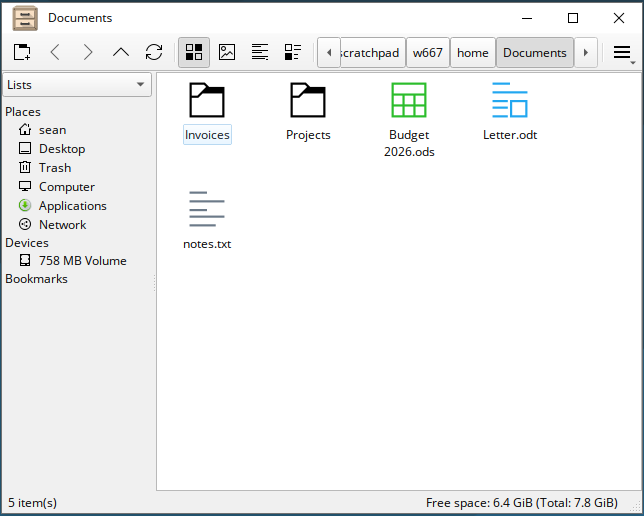
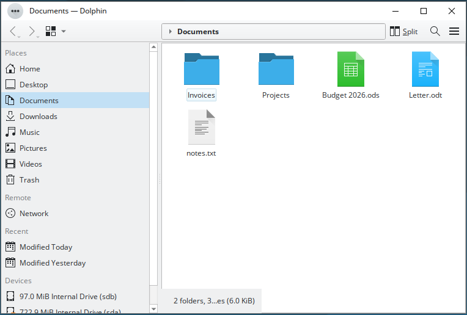
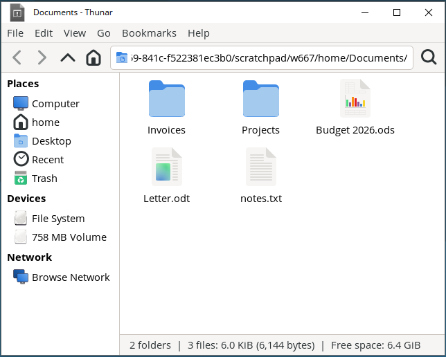
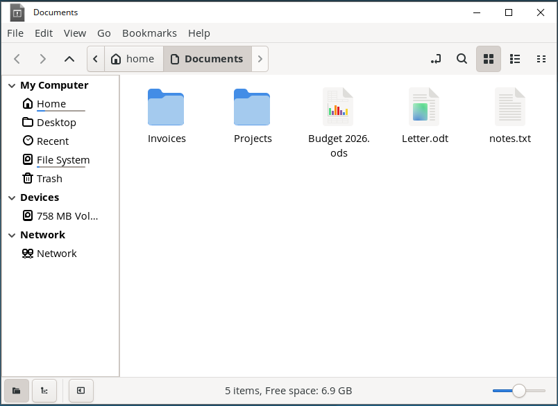
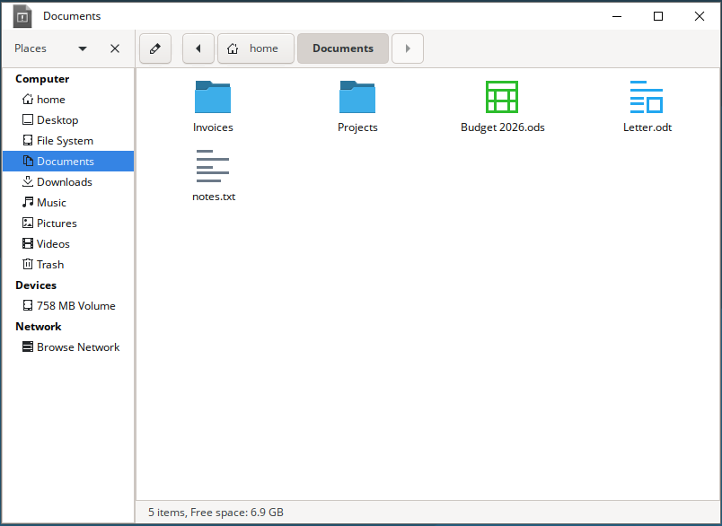
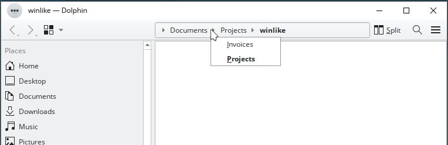
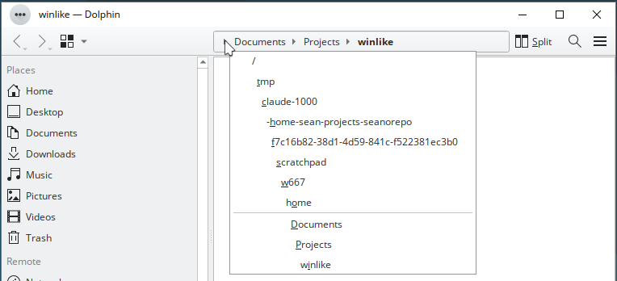

# File managers compared with Windows 10 Explorer

Sean uses File Explorer for most of his day. This page compares six Linux
file managers from Debian 13 with Windows 10 Explorer, and recommends one
for winlike.

## Summary

1. **Dolphin** (KDE) is the closest match. It is the only one with
   Explorer's breadcrumb chevrons: a chevron after each segment lists the
   subfolders, and the leftmost chevron lists the hidden parent folders. Its
   shortcuts are user-configurable, and a config file closes most of the
   remaining key gaps (tested). It is in Debian 13, but it needs `sudo apt`.
2. **Thunar** (Xfce). Backspace goes back, as in Explorer. A click on the
   empty end of the path bar opens the text entry. Users can change every
   shortcut in `~/.config/Thunar/accels.scm`. No chevrons.
3. **PCManFM-Qt** (LXQt, the current winlike file manager). A click on the
   path bar opens the text entry with all text selected, the same as
   Explorer. But Backspace goes up, F4 opens a terminal, Shift+F10 does
   nothing, and users cannot change the shortcuts. No chevrons.
4. **Nemo** (Cinnamon). Breadcrumbs with a toggle button. Backspace goes up.
5. **Caja** (MATE). Breadcrumbs with a toggle button. Backspace goes up.
6. **Nautilus** (GNOME). GTK 4 and libadwaita give it the GNOME look, not
   the winlike look, and the app draws its own title bar. Not a fit.

To install the recommendation, Sean runs this command (it needs root):

```bash
sudo apt-get install --no-install-recommends dolphin
```

This installs 145 packages (32 MB download) on a machine that has winlike.
See [Dolphin config for winlike](#dolphin-config-for-winlike) for the
config that the follow-up issue adds.

## How we tested

- Versions: the Debian 13 packages. Dolphin 25.04.3 (KIO 6.13), Thunar
  4.20.2, Nemo 6.4.5, Caja 1.26.4, Nautilus 48.3, PCManFM-Qt 2.1.0.
- We have no root, so we did not install the packages. We downloaded each
  package and its missing dependencies with `apt-get download` into a new
  empty directory, unpacked them with `dpkg -x` into a scratch prefix, and
  ran the binary with `LD_LIBRARY_PATH`, `XDG_DATA_DIRS` and
  `QT_PLUGIN_PATH` set to that prefix.
- Each test ran in a nested labwc session with the winlike config and a
  throwaway `HOME`. `wtype` sent keys, `wlrctl` moved and clicked the
  pointer, and `grim` took screenshots.
- Nautilus did not start from the scratch prefix: its search library
  (`tinysparql`) loads a module from a fixed path under `/usr/lib`. Facts
  about Nautilus come from its source code.
- **Limit of the key tests.** In the GTK 3 apps (Thunar, Nemo, Caja), keys
  from `wtype` did not start menu shortcuts such as Alt+Up and F2. Key
  bindings inside widgets did work (typing, Esc, Shift+F10 in Thunar). We
  think that the cause is the virtual keyboard of `wtype`, not the apps. For
  those three apps, the shortcut facts come from the source code.

Each claim in the tables has a mark:

- **T**: tested in the nested session.
- **S**: read in the source code of that version.
- **D**: from the project or Microsoft documentation.

The Windows 10 column comes from the Microsoft page
[Keyboard shortcuts in Windows](https://support.microsoft.com/en-us/windows/keyboard-shortcuts-in-windows-dcc61a57-8ff0-cffe-9796-cb9706c75eec)
and from Sean's description of Explorer.

## Screenshots

All screenshots show `~/Documents` in a throwaway `HOME`, with the winlike
theme.

| PCManFM-Qt | Dolphin | Thunar |
|---|---|---|
|  |  |  |

| Nemo | Caja |
|---|---|
|  |  |

Dolphin: a click on the chevron after "Documents" lists its subfolders. The
current folder is bold. This is the Explorer behavior.



Dolphin: a click on the leftmost chevron lists the parent folders that do
not fit in the bar.



## Address bar

Windows 10 Explorer:

- The bar shows breadcrumbs: `This PC > Documents > Projects`.
- A click on empty space in the bar changes it to an editable path, with
  all the text selected.
- Esc puts back the breadcrumbs.
- Each segment has a chevron. A click on it opens a list of the subfolders
  of that segment.
- The leftmost chevron lists root locations (This PC, Desktop, ...) and the
  segments that do not fit.
- Alt+D, Ctrl+L and F4 put the focus in the bar. F4 also opens the list of
  recent locations.
- Typing shows a list of matching paths (autocomplete).
- Enter opens the path. Enter on a command, for example `cmd`, runs it.

| Behavior | Dolphin | Thunar | PCManFM-Qt | Nemo | Caja | Nautilus |
|---|---|---|---|---|---|---|
| Breadcrumb buttons | Yes (T). | Option. The default is a text entry (T, S). | Yes, `PathBarButtons=true` (T). | Yes (T). | Yes (T). | Yes (S). |
| Click on empty space opens the editable path | Yes, text not selected (T). | Yes, in buttons style. The empty end of the bar is a button (S). | Yes, all text selected (S). | No. A separate toggle button (T). | No. A separate pencil button (T). | Not checked. |
| Ctrl+L: editable path, text selected | Yes (T) | Yes (S) | Yes (T) | Yes (S) | Yes (S) | Yes (D) |
| Alt+D | Yes (S, T) | Yes (S) | Yes (S, T) | No (S) | No (S) | No (S) |
| F4 | Toggles a terminal panel (S, T). Config can change it (T). | No binding (S). | Opens a terminal window (T). | No binding (S). | No binding (S). | No binding (S). |
| Autocomplete | List and inline completion (T) | Tab completes (S). No list (T) | List (T) | Inline completion (T) | Inline completion (T) | Not checked |
| Esc after an edit | First Esc closes the list. Second Esc puts back the breadcrumbs (T). | Does not put back the old path in text style (T). | First Esc closes the list. Second Esc puts back the breadcrumbs (T). | Did not revert in the test (T). The source has an Esc binding (S). | One Esc puts back the breadcrumbs (T). | Not checked. |
| Chevron per segment with a subfolder list | Yes (T) | No | No | No | No | No |
| Leftmost chevron with hidden segments | Yes, lists the parent folders (T) | No. Scroll arrows only (T) | No. Scroll arrows only (T) | No. Scroll arrows only (T) | No. Scroll arrows only (T) | No |
| Enter on a command (`cmd`) | No. Dolphin opens the text as a web address in the browser (T) | No | No | No | No | No |
| Middle-click on a segment | Opens a new tab (S). | Not checked. | Opens a new tab (S). | Not checked. | Not checked. | Not checked. |

## Keyboard shortcuts

| Key | Windows 10 | Dolphin | Thunar | PCManFM-Qt | Nemo | Caja |
|---|---|---|---|---|---|---|
| Alt+Up | Up one level | Yes (T) | Yes (S) | Yes (T) | Yes (S) | Yes (S) |
| Alt+Left | Back | Yes (T) | Yes (S) | Yes (T) | Yes (S) | Yes (S) |
| Backspace | Back | **Back** (T) | **Back** (S) | Up (T) | Up (S) | Up (S) |
| F2 | Rename | Yes (S) | Yes, in a dialog (S) | Yes, in place (T) | Yes (S) | Yes (S) |
| F4 | Address bar list | Terminal panel (T) | None (S) | Terminal window (T) | None (S) | None (S) |
| Ctrl+L, Alt+D | Address bar | Yes (T) | Yes (S) | Yes (T) | Ctrl+L only (S) | Ctrl+L only (S) |
| Ctrl+Shift+N | New folder. | Yes, in a dialog (T). | Yes, in a dialog (S). | Yes, in a dialog (T). | Yes (S). | Yes (S). |
| Ctrl+E, Ctrl+F | Search box | Ctrl+F only (S). Config adds Ctrl+E (T) | Ctrl+F only. Ctrl+E shows the tree pane (S) | Ctrl+F and F3: a search dialog (S) | Ctrl+F only (S) | Ctrl+F only (S) |
| Alt+Enter | Properties | Yes (T) | Yes (S) | Yes (T) | Yes (S) | Yes (S) |
| Shift+F10 | Context menu | Yes (T) | Yes (T) | **No** (T) | GTK default: yes (D) | GTK default: yes (D) |
| Menu key | Context menu | Yes (T) | Yes (D) | Yes (T) | Yes (D) | Yes (D) |
| Ctrl+Shift+1 to 8 | View mode | No. Ctrl+1 to 3 (S). Config adds them (T) | No. Ctrl+1 to 3 (S) | No | No | No |
| Ctrl+N, Ctrl+W | New window, close | Yes (S) | Yes (S) | Yes (T) | Yes (D) | Yes (D) |
| F5 | Refresh | Yes (S) | Yes (S) | Yes (S) | Yes (S) | Yes (D) |
| F6 | Cycle focus | Toggles editable location (S) | None | Split view (S) | Other pane (S) | Not checked |
| Users can change the shortcuts | Yes. | Yes, KXmlGui file (T). | Yes, `accels.scm` (S). | **No** (S). | Yes, GTK accel map file (S). | Yes, GTK accel map file (D). |

Notes:

- PCManFM-Qt sets its extra shortcuts in code (`pcmanfm/mainwindow.cpp`).
  Backspace calls `on_actionGoUp_triggered()`. No setting changes this.
- Nemo and Caja bind Backspace to the "go-up" signal in a GTK binding set,
  not in the accel map. The accel map file cannot change it.

## Navigation pane

Windows 10 has one tree: Quick access (pinned and frequent folders), This
PC (user folders and drives), Network. Each node expands. Ctrl+Shift+E
expands the tree to the current folder.

| File manager | Navigation pane |
|---|---|
| Dolphin | Places panel: Home, user folders, Trash, Network, Recent, Devices (T). A separate Folders panel (F7) gives a tree (D). Users can hide groups and pin folders. |
| Thunar | Shortcuts pane (Ctrl+B) or tree pane (Ctrl+E), not both at once (S) |
| PCManFM-Qt | Places list or a directory tree, chosen in a drop-down above the pane (T) |
| Nemo | Places list with collapsible groups (T). A tree view is a second mode (D). |
| Caja | Places list (T). Tree, history and notes are other modes (D). |

None has a combined "Quick access + This PC" tree. Dolphin with the Places
panel and the Folders panel is the closest.

## View modes and column headers

Windows 10 has eight views: extra large, large, medium and small icons,
list, details, tiles, content. Details has sortable column headers: Name,
Date modified, Type, Size. Ctrl+mouse wheel changes the icon size.

| File manager | Views | Details columns |
|---|---|---|
| Dolphin | Icons, Compact, Details (S). Zoom slider and Ctrl+wheel (D) | Name, Size, Modified by default (T). Right-click on the header adds Type and others (D) |
| Thunar | Icons, Detailed list, Compact list (S) | Configurable (D) |
| PCManFM-Qt | Icons, Thumbnails, Compact, Detailed list (T) | Configurable (D) |
| Nemo | Icons, List, Compact (T) | Configurable (D) |
| Caja | Icons, List, Compact (D) | Configurable (D) |

## Context menus

- Explorer: Open, Open in new window, Pin to Quick access, Share, Give
  access to, Restore previous versions, Send to, Cut, Copy, Create shortcut,
  Delete, Rename, Properties.
- Dolphin: Create New, Open Folder With, Add to Places, Sort By, Change View
  Mode, Open Terminal Here, Properties on the background (T). Items show
  their shortcut keys.
- Thunar: Open, Open in new Tab, Open in new Window, Open With, Send To,
  Cut, Copy, Paste Into Folder, Move to Trash, Rename, Properties (T). This
  list is the closest to Explorer's.
- PCManFM-Qt: Open, Open With, Open in New Tab, Open in New Window, Open in
  Terminal, Create New, Cut, Copy, Paste, Move to Trash, Rename, Compress,
  Properties (T).

All three are close enough. Thunar has "Send To", as Explorer has.

## File dialogs

Windows apps use one Open/Save dialog, which looks like Explorer. In
winlike, the dialog depends on the toolkit of the app:

| App toolkit | Dialog today | Tested |
|---|---|---|
| Qt (FeatherPad, PCManFM-Qt) | LXQt platform plugin: the libfm-qt dialog, with a path bar, places and a details list | T (FeatherPad, Ctrl+O) |
| GTK 3 or 4 | The GTK file chooser. It does not look like Explorer. winlike has `xdg-desktop-portal-lxqt`, but not the portal front end (`xdg-desktop-portal`). Thus GTK apps cannot use the LXQt dialog. | Package list checked |
| KDE apps with Dolphin | The libfm-qt dialog, because winlike sets `QT_QPA_PLATFORMTHEME=lxqt`. The KDE dialog needs the `kde` platform theme | D |

See [gaps.md](gaps.md), item "File dialogs".

## Dolphin config for winlike

These settings close most of the Explorer gaps. We tested the shortcut
overrides in the nested session (F4, Ctrl+E and Ctrl+Shift+6 worked).

`~/.local/share/kxmlgui5/dolphin/dolphinui.rc` is a copy of the Dolphin
`dolphinui.rc` (version 43, from the Dolphin source) with these lines added
in `<ActionProperties>`. One attribute value can hold more than one key:
KXmlGui separates them with a semicolon.

```xml
<Action name="edit_find" shortcut="Ctrl+F; Ctrl+E"/>
<Action name="replace_location" shortcut="Ctrl+L; Alt+D; F4"/>
<Action name="show_terminal_panel" shortcut=""/>
<Action name="icons" shortcut="Ctrl+1; Ctrl+Shift+2"/>
<Action name="details" shortcut="Ctrl+3; Ctrl+Shift+6"/>
```

The copy must have the same `version` as the file inside Dolphin. When
Debian updates Dolphin to a new version of this file, Dolphin ignores the
copy. The follow-up issue must handle this, for example with a check in
`install.sh`.

Other gaps that config can close (from the Dolphin documentation, not
tested):

- `dolphinrc`, `[General] RememberOpenedTabs=false`: start with one tab, as
  Explorer does. (In our test, Dolphin opened the tabs of the last session.)
- `kdeglobals`, `[KDE] SingleClick=false`: double-click opens a file. This
  is the KDE 6 default.
- Global view properties: Details view with Name, Modified, Type and Size
  columns.
- Win+E in `rc.xml`: `dolphin` in place of `pcmanfm-qt`. Keep
  `pcmanfm-qt --desktop` for the desktop icons.

Gaps that config cannot close in Dolphin:

- A click on empty space does not select the path text. Ctrl+L does.
- F4 does not open the recent-locations list. With the config above, F4
  selects the path, which is the most frequent use.
- Enter on a command does not run it.
- The navigation pane has no "Quick access + This PC" tree.

## Ranked recommendation

| Rank | File manager | Why | Config closes |
|---|---|---|---|
| 1 | Dolphin | Breadcrumb chevrons, the leftmost chevron, click to edit, autocomplete list, Backspace goes back, Shift+F10, user-configurable shortcuts. Qt, so it uses the winlike Fusion palette. | F4, Ctrl+E, Ctrl+Shift+1 to 8, no terminal panel, one tab at start |
| 2 | Thunar | Backspace goes back. A click on the empty end of the path bar opens the entry. Shortcuts in `accels.scm`. Explorer-like context menu with "Send To". GTK 3, so it uses the winlike GTK theme (Adwaita today). | Shortcuts (`accels.scm`), buttons style (`xfconf`). |
| 3 | PCManFM-Qt | Click to edit with the text selected, autocomplete list, two-step Esc. Already installed. | Nothing for shortcuts. The code sets them. |
| 4 | Nemo | Breadcrumbs, inline completion | Some shortcuts (accel map) |
| 5 | Caja | Breadcrumbs, inline completion, one-step Esc | Some shortcuts (accel map) |
| 6 | Nautilus | GTK 4 and libadwaita: GNOME look, own title bar | Little |

Dolphin needs root to install, so this branch does not change the file
manager. A follow-up issue switches Win+E to Dolphin and adds the config
above.
