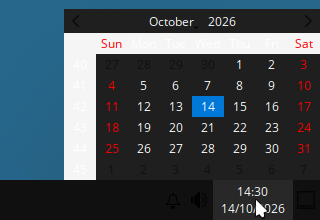
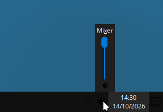

# Windows 10 details that winlike does not copy yet

This page lists Windows 10 details that winlike does not copy. The list
starts with the gaps that Sean meets most often.

Effort:

- **S**: config only, one or two files, less than one hour.
- **M**: a script or several config files, or a package change. Half a day.
- **L**: new code, or a new component. More than one day.

Each item says how we know the facts:

- **T**: tested in a nested labwc session with the winlike config.
- **S**: read in the source code.
- **D**: from documentation or a log file.

Other work that is already merged, so this page does not repeat it:

- #665: Debian assets in place of Microsoft assets, and true app names.
- #666: Ghostty terminal with zsh.
- #668: full screen and keyboard capture (Win key, Alt+Tab).
- The README section "Known gaps": start menu popup, Recycle Bin label,
  Alt+Tab thumbnails, quarter snap and Snap Assist, Win+L, Task View,
  taskbar button previews.

## Ranked list

| Rank | Gap | Effort | Issue |
|---|---|---|---|
| 1 | Keyboard layout and regional format | S | #672 |
| 2 | Explorer-like file manager | M | #673 |
| 3 | File dialogs | M | #674 |
| 4 | Consistent GTK and Qt look | M | #675 |
| 5 | Clock and volume flyouts | M | #676 |
| 6 | Action Center and notification look | L | #677 |
| 7 | Search on the taskbar | S | #678 |
| 8 | Alt menu accelerators | M | None yet |
| 9 | Sounds | M | None yet |
| 10 | Mouse acceleration and scroll speed | S | None. Nothing to change in WSLg |
| 11 | Num Lock at start | S | None yet |
| 12 | Command prompt look | S | None. Not useful |

## 1. Keyboard layout and regional format

**Windows 10:** the keyboard layout and the regional format (date order,
first day of the week, 24-hour clock) come from Windows settings.

**winlike:**

- The WSLg log shows the Windows keyboard: `kbd_layout:0x809` and
  `layout=gb` (D, `/mnt/wslg/weston.log`).
- labwc makes its own keymap from the `XKB_DEFAULT_*` variables. The
  default layout is `us` (D, labwc documentation). winlike sets only
  `XKB_DEFAULT_OPTIONS=winlike:capture` (from #668) in
  `.config/labwc/environment`, not the layout. Thus apps in winlike
  probably get a US layout on a UK keyboard: `"` and `@` change places, and
  `#` and `\` move. We did not test this with a physical key, because the
  test sends keys through `wtype`, which has its own keymap.
- The locale is `en_US.UTF-8`, and `en_US` is the only English locale on the system (D, `locale -a`). The clock
  flyout starts the week on Sunday (T, screenshot below). Dolphin shows US
  dates (T).

**Fix:** set `XKB_DEFAULT_LAYOUT` from the WSLg layout, or from a value in
the install script. Generate `en_GB.UTF-8` (needs root:
`sudo sed -i 's/^# en_GB.UTF-8/en_GB.UTF-8/' /etc/locale.gen && sudo locale-gen`)
and set `LANG` or `LC_TIME` in the labwc environment.

## 2. Explorer-like file manager

**Windows 10:** see [file-managers.md](file-managers.md). The address bar
has breadcrumb chevrons, click to edit, autocomplete, and F4. Backspace
goes back.

**winlike:** PCManFM-Qt has no chevrons, Backspace goes up, F4 opens a
terminal, Shift+F10 does nothing (T). Users cannot change its shortcuts (S).

**Fix:** install Dolphin (`sudo apt-get install --no-install-recommends
dolphin`), bind Win+E to it, and add the shortcut config from
[file-managers.md](file-managers.md#dolphin-config-for-winlike). Keep
`pcmanfm-qt --desktop` for the desktop.

## 3. File dialogs

**Windows 10:** all apps use the same Open and Save dialog, with the
Explorer address bar and navigation pane.

**winlike:**

- Qt apps use the libfm-qt dialog of the LXQt platform plugin: path bar,
  places, details list (T, FeatherPad Ctrl+O).
- GTK apps use the GTK file chooser. `xdg-desktop-portal-lxqt` is
  installed, but the front end `xdg-desktop-portal` is not (D, `dpkg`).
  Thus a GTK app cannot ask the portal for the LXQt dialog.

**Fix:** install `xdg-desktop-portal` (needs root). Start it in the labwc
session with the LXQt backend. Set `GDK_DEBUG=portals` (GTK 3.24 and GTK 4)
so that GTK apps use the portal file chooser. Test with a GTK app and with
Firefox (`widget.use-xdg-desktop-portal.file-picker=1`).

## 4. Consistent GTK and Qt look

**Windows 10:** all Win32 apps share one set of controls: buttons, check
boxes, scroll bars with arrow buttons, `#0078d7` selection in lists and
menus, `#cce8ff` selection in the Explorer file view.

**winlike:**

- GTK 3 apps use Adwaita, the GTK default (#665 removed the B00merang
  theme). Qt apps use the Fusion style with a Windows palette. The two look
  different: compare the Thunar and PCManFM-Qt screenshots in
  [file-managers.md](file-managers.md) (T).
- GTK 4 and libadwaita apps have the GNOME look (D).
- The Qt palette uses `#0078d7` for every selection (D, `lxqt.conf`). Kali
  Undercover uses the Explorer color `#cce8ff` with black text (S, see
  [kali-undercover.md](kali-undercover.md)).
- winlike does not set the GNOME `color-scheme` key. Firefox and GTK 4 apps
  read it to choose light or dark (D).

**Fix:** pick one way to style Qt like the GTK theme, for example the
Kvantum engine (`qt6-style-kvantum` is in Debian 13) with a Windows 10
Kvantum theme, or a QSS file. Set `color-scheme` to `default` (light). Check
the result with screenshots of the same dialog in a GTK app and a Qt app.

## 5. Clock and volume flyouts

**Windows 10:** a click on the clock opens a flyout with the time in large
text and a calendar. A click on the speaker opens a horizontal volume
slider with the output device name.

**winlike:**

- The clock opens a small dark calendar that starts on Sunday, without the
  large time. The weekday names are dark on a dark background, and the
  popup touches the right edge of the screen (T, screenshot in item 1).
- The speaker opens a narrow vertical slider labeled "Mixer" (T).

**Fix:** set the `worldclock` popup options and the locale (item 1).
Style the `volume` popup with the LXQt panel QSS. If the plugin cannot do a
horizontal slider, write a small Qt flyout. This is the M part.

## 6. Action Center and notification look

**Windows 10:** notifications slide in at the bottom right, dark, for about
5 seconds. The Action Center button at the right end of the taskbar opens a
panel with the notification history and quick actions.

**winlike:**

- `lxqt-notificationd` shows the notification at the bottom right (T). Its
  source default is `bottom-right` (S).
- The notification is white, not dark (T).
- After a notification, a bell icon appears in the tray (T). There is no
  Action Center panel and no quick actions.

**Fix:** S part: notification colors and timeout in the LXQt notification
config and theme. L part: an Action Center panel. Find an existing
layer-shell panel first.

## 7. Search on the taskbar

**Windows 10:** a search box (or a search button) next to the start button.
Win+S opens it.

**winlike:** no search box and no Win+S (D, `rc.xml`). Win+R opens
`lxqt-runner`, which can search apps. Kali Undercover puts an app finder
launcher in this place (S).

**Fix:** bind Win+S to `lxqt-runner`. Add a quick-launch button with a
search icon next to the start button.

## 8. Alt menu accelerators

**Windows 10:** the underline under the access key shows only after the
user presses Alt. Alt alone, or F10, moves the focus to the menu bar.

**winlike:** not tested. GTK 3 hides the underlines until the user presses Alt
(D, `gtk-auto-mnemonics`). We did not check the Qt Fusion style. The
`wtype` test tool does not start GTK menu shortcuts (see
[file-managers.md](file-managers.md#how-we-tested)), so this needs a test
with a real keyboard.

**Fix:** test first. Then set the Qt style hint or GTK setting that
matches Windows. Effort M, because Qt can need a style plugin change.

## 9. Sounds

**Windows 10:** sounds for notifications, errors, the recycle bin and
device connect.

**winlike:** no event sounds. `sound-theme-freedesktop` is not installed
(D, `apt-cache policy`). WSLg gives audio through its PulseAudio server.

**Fix:** install a sound theme and set `gtk-enable-event-sounds`. Qt apps
do not play event sounds without KDE parts. Low value.

## 10. Mouse acceleration and scroll speed

**Windows 10:** "Enhance pointer precision" is on. One wheel notch scrolls
3 lines.

**winlike:** in WSLg, Windows moves the pointer and applies its own
acceleration before WSLg sends the position. labwc `<libinput>` settings
apply only to local libinput devices. Qt scrolls 3 lines per notch
(`wheelScrollLines=3` in `lxqt.conf`). Nothing to change in WSLg. On
bare metal, add a `<libinput>` block with `accelProfile` set to
`adaptive`.

## 11. Num Lock at start

**Windows 10:** Num Lock is on at the sign-in screen on most desktop PCs.

**winlike:** not set. labwc has a `<keyboard><numlock>` option (D). In
WSLg, the state of the Windows key light can differ from the state in
labwc. Not tested.

## 12. Command prompt look

Kali Undercover sets the prompt to `C:\path>` (S). This is a disguise. It
does not help daily work. #666 sets up the terminal. Not worth an issue.
